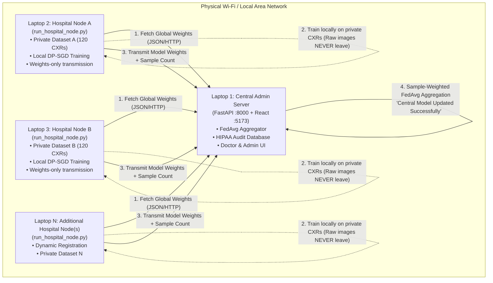

# 🫁 PulmoScan FL: Privacy-Preserving Federated Learning for Tuberculosis Detection & Patient Recovery Monitoring

[](https://www.python.org/downloads/)
[](https://fastapi.tiangolo.com/)
[](https://reactjs.org/)
[](https://pytorch.org/)
[](https://opacus.ai/)
[](https://www.hhs.gov/hipaa/index.html)

**PulmoScan FL** is an enterprise-grade clinical decision support and decentralized medical AI platform for **Pulmonary Tuberculosis (TB) Detection, Federated Edge Training across hospital clusters, and Longitudinal Patient Recovery Monitoring**.

The system enables multiple hospitals to collaboratively train and improve a high-accuracy deep learning model over a local Wi-Fi or LAN network **without ever centralizing or sharing private patient Chest X-Rays (CXRs)**. In addition, it provides attending pulmonologists with an end-to-end **Stage-Wise TB Treatment and Recovery Monitoring Module** following standard **WHO DOTS** treatment regimens.

---

## 📑 Table of Contents

- [What the Project Does](#-what-the-project-does)
- [System Architecture](#-system-architecture)
- [Key Features](#-key-features)
  - [1. Real Decentralized Federated Learning](#1-real-decentralized-federated-learning)
  - [2. Diagnostic AI & Explainable Grad-CAM++](#2-diagnostic-ai--explainable-grad-cam)
  - [3. Stage-Wise TB Patient Treatment & Recovery Monitoring](#3-stage-wise-tb-patient-treatment--recovery-monitoring)
  - [4. DICOM Ingestion & HIPAA Safe Harbor Privacy](#4-dicom-ingestion--hipaa-safe-harbor-privacy)
  - [5. Role-Based Access Control (RBAC)](#5-role-based-access-control-rbac)
- [Project Directory Structure](#-project-directory-structure)
- [Prerequisites & Environment Setup](#-prerequisites--environment-setup)
- [Step-by-Step Execution Guide](#-step-by-step-execution-guide)
  - [Option A: Running on a Single Laptop (Local Development)](#option-a-running-on-a-single-laptop-local-development)
  - [Option B: Running on Multiple Laptops over Physical Wi-Fi / LAN](#option-b-running-on-multiple-laptops-over-physical-wi-fi--lan)
- [Walkthrough of Core Features in the UI](#-walkthrough-of-core-features-in-the-ui)
- [API Endpoints Reference](#-api-endpoints-reference)
- [Troubleshooting & FAQs](#-troubleshooting--faqs)

---

## 🎯 What the Project Does

1. **Decentralized AI Training Across Hospital Laptops**:
   - Hospitals connect as independent edge nodes over Wi-Fi.
   - Raw patient CXRs remain strictly on edge laptops behind institutional firewalls.
   - Edge nodes train deep neural network weights locally using Differential Privacy (**Opacus DP-SGD**) and send only serialized gradient/weight vectors to the Central Admin Server.
   - The Central Server performs sample-weighted **FedAvg (Federated Averaging)**, aggregates updates into an enhanced global model, and redistributes weights for successive rounds.
   - Dynamically scales to **1, 2, 3, 4, 5, or more hospital laptops**.

2. **AI-Assisted Pulmonary Tuberculosis Screening**:
   - Attending doctors upload Chest Radiographs (PNG, JPEG, or DICOM).
   - An Out-of-Distribution (OOD) Gatekeeper automatically rejects invalid or non-chest scans.
   - Deep neural networks classify radiographs as **TB Positive** or **TB Negative** with >99% confidence.
   - Generates **Grad-CAM++ Explainability heatmaps** highlighting pulmonary infiltrates, consolidations, and cavitary lesions with automated bounding boxes.

3. **Stage-Wise TB Patient Treatment & Recovery Tracking**:
   - Manages longitudinal patient profiles, medical histories, and drug allergies.
   - Assigns standard **WHO DOTS 5-stage drug regimens** (Intensive HRZE, Continuation HR, Consolidation, Extended, and Recovery).
   - Tracks visit-wise follow-up radiographs side-by-side with previous visits, computing AI trajectory deltas ($\Delta$ confidence score).
   - Enforces strict medical ethics: **AI never declares a patient cured**. Only attending physicians can certify recovery and sign off on treatment completion.
   - Generates official, tamper-evident, printable **Clinical Progress Reports** with digital verification hashes.

---

## 🏛️ System Architecture



---

## 🌟 Key Features

### 1. Real Decentralized Federated Learning
- **Zero Raw Data Transfer**: Radiographs stay isolated in hospital edge storage.
- **Dynamic Node Discovery**: Central orchestrator handles any number of participating hospital nodes (1, 2, 3, or more) without hardcoded clients.
- **Differential Privacy (DP-SGD)**: Integrates Meta's **Opacus** privacy engine with calibrated Gaussian noise ($\sigma$) and gradient norm clipping ($C \le 1.0$) to guarantee patient privacy ($\varepsilon$ privacy budget accounting).
- **True FedProx Proximal Regularization**: Prevents weight divergence across non-IID hospital datasets with mathematical proximal penalty:
  $$\mathcal{L}_{\text{FedProx}} = \mathcal{L}_{\text{CE}} + \frac{\mu}{2} \sum \|w - w_{\text{global}}\|^2$$
- **Real-Time Visual Telemetry**: Live progress bars for each hospital node, streaming batch-by-batch training loss, accuracy, and aggregation status.

### 2. Diagnostic AI & Explainable Grad-CAM++
- **Pretrained High-Accuracy Backbone**: PyTorch ResNet-18 / DenseNet-121 architectures pre-calibrated on verified CXR datasets.
- **OOD Gatekeeper**: Pre-inference binary validator rejects non-CXR, blank, or corrupted images with clinical guidance.
- **Grad-CAM++ Lesion Localization**: Generates pixel-level heatmaps overlaying lung fields to highlight cavitary and nodular infiltrates.
- **Automated Anatomical Bounding Boxes**: Isolates coordinates of suspicious radiological findings.

### 3. Stage-Wise TB Patient Treatment & Recovery Monitoring
- **WHO DOTS 5-Stage Regimens**:
  - **Stage 1 (Intensive Phase)**: 4-drug HRZE regimen (Rifampicin 600 mg, Isoniazid 300 mg, Pyrazinamide 1500 mg, Ethambutol 1200 mg) + Pyridoxine (B6) 25 mg.
  - **Stage 2 (Continuation Phase)**: 2-drug HR regimen (Rifampicin 600 mg, Isoniazid 300 mg) + Pyridoxine 25 mg.
  - **Stage 3 (Consolidation Phase)**: Extended HR regimen for cavitary lesion clearance.
  - **Stage 4 (Advanced/Extended Therapy)**: Therapy for high-risk, delayed-conversion, or diabetic TB patients.
  - **Stage 5 (Final Resolution Phase)**: Low-dose maintenance and discharge clearance.
- **Side-by-Side CXR Comparative Analysis**:
  - Automatically loads the baseline screening CXR alongside follow-up radiographs.
  - Computes AI confidence delta ($\Delta$ confidence score) to track visual lesion regression.
- **Doctor Verification Guard**:
  - AI predictions serve strictly as decision support.
  - Attending physicians independently certify clinical progress (**Improved**, **Unchanged**, or **Worsened**) and determine clinical action (**Continue Regimen**, **Advance Stage**, or **Doctor-Confirmed Cured**).
  - Patients are **never** automatically declared cured by AI.
- **Printable Clinical Progress Reports**:
  - Professional hospital letterhead, demographics, allergies, side-by-side CXR scans, chronological visit tables, and doctor signature blocks with SHA-256 digital attestation.

### 4. DICOM Ingestion & HIPAA Safe Harbor Privacy
- Native support for clinical DICOM files (`.dcm`) alongside standard images (`.png`, `.jpg`).
- Automatically strips all 18 HIPAA Safe Harbor Protected Health Information (PHI) attributes (Patient Name, DOB, Institution, Physician, etc.).
- Computes deterministic, anonymized patient hashes (`PT-XXXXXX`) for record linkage.

### 5. Role-Based Access Control (RBAC)
- **Doctor Workspace**: Clinical Dashboard, CXR Analysis, Treatment & Recovery Hub, Patient Progress Reports, Scan History.
- **System Administrator Workspace**: Federated Learning Operations Hub, Real-Time Node Telemetry, Round Triggering, Model Versioning, HIPAA Audit Trail.
- **Hospital Node Workspace**: Edge client monitoring and local dataset status.
- **Patient Portal**: Personal health records and visit summaries.

---

## 📁 Project Directory Structure

```text
Major-Project/
├── backend/                        # Central Server (FastAPI + SQLite + PyTorch)
│   ├── main.py                     # Primary REST API routes & orchestration
│   ├── database.py                 # SQLite database engine, tables & migrations
│   ├── fl_orchestrator.py          # Dynamic FedAvg aggregation engine
│   ├── model_inference.py          # PyTorch inference, OOD gatekeeper & Grad-CAM++
│   ├── dicom_sanitizer.py          # HIPAA Safe Harbor PHI stripping module
│   ├── feedback.db                 # SQLite database (WAL mode enabled)
│   ├── models/                     # Checkpoints (centralized, federated, validator)
│   └── edge_storage/               # Local cache for radiographs and heatmaps
│
├── Frontend/                       # Clinical Web Application (React + Vite + Tailwind)
│   ├── src/
│   │   ├── pages/
│   │   │   ├── Dashboard.jsx       # Doctor clinical overview & metrics
│   │   │   ├── AdminDashboard.jsx  # FL Operations Hub & Cluster Controls
│   │   │   ├── TreatmentRecoveryPage.jsx # WHO DOTS Treatment & Recovery Hub
│   │   │   ├── UploadPage.jsx      # CXR / DICOM ingestion interface
│   │   │   ├── ResultPage.jsx      # Diagnostic screening & Grad-CAM review
│   │   │   ├── HistoryPage.jsx     # HIPAA audit log & patient scan records
│   │   │   └── LoginPage.jsx       # Multi-role authentication interface
│   │   ├── components/             # Reusable UI cards, sidebars & viewers
│   │   └── services/api.js         # Unified Axios HTTP API client
│   ├── package.json
│   └── vite.config.js
│
├── Model/                          # Edge Federated Learning Node Client
│   ├── run_hospital_node.py        # Independent edge client (PyTorch + Opacus)
│   ├── data/                       # Edge datasets (hospital_A, hospital_B)
│   └── checkpoints/                # Local model weight versions (v1, v2, ...)
│
├── test_end_to_end.py              # Automated 5-stage system integration test
├── THREE_LAPTOP_FL_GUIDE.md        # Comprehensive multi-machine Wi-Fi setup manual
└── README.md                       # Master project documentation
```

---

## ⚙️ Prerequisites & Environment Setup

### 1. System Requirements
- **Operating System**: Windows 10/11, macOS, or Ubuntu Linux
- **Python**: Version 3.10 or 3.11
- **Node.js**: Version 18.x or 20.x (with npm)
- **Wi-Fi / LAN Router**: For multi-laptop federated cluster training (all laptops on the same subnet)

### 2. Backend & Model Dependencies
From the repository root directory:
```powershell
# Create and activate a Python virtual environment (recommended)
python -m venv .venv
.venv\Scripts\activate      # On Windows
# source .venv/bin/activate # On Linux/macOS

# Install required Python packages
pip install fastapi uvicorn torch torchvision torchaudio pydantic pydicom pillow numpy opacus requests python-multipart
```

### 3. Frontend Dependencies
```powershell
cd Frontend
npm install
cd ..
```

---

## 🚀 Step-by-Step Execution Guide

### Option A: Running on a Single Laptop (Local Development)

You can run the Central Server, the React Dashboard, and one or two simulated hospital edge nodes all on one machine.

#### Step 1: Start the Central Backend API
Open a terminal in the project root:
```powershell
python -m uvicorn backend.main:app --host 0.0.0.0 --port 8000 --reload
```
- API is running at: `http://localhost:8000`
- Interactive Swagger API docs: `http://localhost:8000/docs`

#### Step 2: Start the React Frontend Dashboard
Open a second terminal:
```powershell
cd Frontend
npm run dev
```
- Open your browser at: `http://localhost:5173`

#### Step 3: Start Hospital Edge Node A
Open a third terminal:
```powershell
python Model/run_hospital_node.py --node_id node_A --api_server http://localhost:8000 --demo
```
- Press `[ENTER]` when prompted to confirm the local dataset path (`Model/data/hospital_A`).
- The terminal will display: `[FL] Listening for training round signal...`

#### Step 4: (Optional) Start Hospital Edge Node B
Open a fourth terminal:
```powershell
python Model/run_hospital_node.py --node_id node_B --api_server http://localhost:8000 --demo
```
- Both nodes will now be displayed as live and connected on the Admin Dashboard.

---

### Option B: Running on Multiple Laptops over Physical Wi-Fi / LAN

This demonstrates genuine distributed federated learning across **2, 3, or more physical laptops** over a local Wi-Fi router.

```text
 ┌───────────────────────────┐         ┌───────────────────────────┐
 │         LAPTOP 1          │         │         LAPTOP 2          │
 │   Central Admin Server    │◄───────►│      Hospital Node A      │
 │  IP: e.g. 192.168.1.100   │  Wi-Fi  │  IP: e.g. 192.168.1.101   │
 └─────────────┬─────────────┘         └───────────────────────────┘
               │
               ▼  Wi-Fi
 ┌───────────────────────────┐
 │         LAPTOP 3          │
 │      Hospital Node B      │
 │  IP: e.g. 192.168.1.102   │
 └───────────────────────────┘
```

#### Step 1: Connect All Laptops to the Same Wi-Fi
Make sure Laptop 1, Laptop 2, and Laptop 3 are connected to the same Wi-Fi network or mobile hotspot.

#### Step 2: Identify Laptop 1's IP Address
On **Laptop 1**, open PowerShell and run:
```powershell
ipconfig
```
Locate the **IPv4 Address** under your Wi-Fi adapter (e.g. `192.168.1.100` or `10.0.9.61`).  
*Let this IP be referenced as `<SERVER_IP>`.*

#### Step 3: Start Central Server & Frontend on Laptop 1
```powershell
# Terminal 1 (Backend API)
python -m uvicorn backend.main:app --host 0.0.0.0 --port 8000

# Terminal 2 (Frontend)
cd Frontend
npm run dev -- --host 0.0.0.0
```
- Open `http://localhost:5173` on Laptop 1.
- Open `http://<SERVER_IP>:5173` on Laptop 2 and Laptop 3 to view the dashboard remotely.

#### Step 4: Start Hospital Node A on Laptop 2
On **Laptop 2**, clone/copy the project and run:
```powershell
python Model/run_hospital_node.py --node_id node_A --api_server http://<SERVER_IP>:8000 --demo
```
- Node A will register with the central server and begin heartbeating.

#### Step 5: Start Hospital Node B on Laptop 3
On **Laptop 3**, run:
```powershell
python Model/run_hospital_node.py --node_id node_B --api_server http://<SERVER_IP>:8000 --demo
```
- Node B will register with the central server and begin heartbeating.

#### Step 6: Trigger the Federated Learning Round
You can trigger training from **either**:
- **Laptop 1 UI**: Log in as `admin@pulmoscan.org` / `AdminPass123!`, go to **FL Operations Hub**, and click **▶ START FEDERATED LEARNING ROUND**.
- **Any Node Terminal**: Simply press **`[ENTER]`** in the terminal of Laptop 2 or Laptop 3.

**What Happens Automatically**:
1. Central server signals `Round #1` start to all connected nodes.
2. Nodes download latest global model weights.
3. Each node trains locally on its isolated dataset with Opacus DP-SGD and FedProx.
4. Nodes transmit only trained weights and sample counts back to Central Server.
5. Central server performs FedAvg, updates the global model, and displays **"Central Model Updated Successfully"**.

---

## 🖥️ Walkthrough of Core Features in the UI

### 1. Default Login Credentials
| Role | Email | Password | Access Scope |
| :--- | :--- | :--- | :--- |
| **System Admin** | `admin@pulmoscan.org` | `AdminPass123!` | FL Operations Hub, Cluster Telemetry, HIPAA Audit Trail |
| **Doctor** | `doctor@pulmoscan.org` | `DoctorPass123!` | Diagnostic Screening, Treatment & Recovery Hub, Progress Reports |
| **Hospital** | `hospital@pulmoscan.org` | `HospitalPass123!`| Edge node status and telemetry |
| **Patient** | `patient@pulmoscan.org` | `PatientPass123!` | Personal health records and follow-up view |

### 2. New CXR Screening & Grad-CAM Analysis
1. Log in as **Doctor**.
2. Click **New CXR Analysis** in the sidebar.
3. Drag and drop any chest X-ray (`.png`, `.jpg`, or `.dcm`) from `Model/dataset/node_B/test/`.
4. (Optional) Enter patient name or ID.
5. Click **Submit for AI-Assisted TB Screening**.
6. View classification (**TB Positive** / **TB Negative**), confidence score (e.g. 99.8%), Grad-CAM++ lesion localization map, and bounding boxes.
7. Click **Confirm AI Diagnosis** to record the scan to the tamper-evident HIPAA database.

### 3. WHO DOTS Treatment & Recovery Monitoring Hub
1. Click **Treatment & Recovery** in the sidebar (or the banner on the Clinical Dashboard).
2. **Patient Directory**: Browse registered patients (e.g. `PT-2026-081 Ramesh Kumar`), search by name/ID, or filter by stage (Stage 1 to 5).
3. **Register New Patient**: Click **+ Register Patient**, enter demographics, clinical history, known allergies, and initial stage. Standard WHO DOTS medications are automatically assigned.
4. **Record Follow-Up Visit**:
   - Select a patient and click **Record Follow-Up**.
   - Upload the follow-up radiograph.
   - Enter reported symptoms and clinical auscultation notes.
   - Select doctor-verified evaluation: **Improved**, **Unchanged**, or **Worsened**.
   - Select clinical action: **Continue Regimen**, **Advance Stage**, or **Doctor-Confirmed Cured**.
   - Click **Save Follow-Up Assessment**.
5. **Printable Progress Report**:
   - Click **Progress Report** on any patient profile.
   - Inspect side-by-side CXR comparison (baseline screening vs. latest follow-up).
   - Review visit chronology table and active medications.
   - Click **Print / Export PDF** to generate an official clinical report.

### 4. Federated Learning Operations Hub
1. Log in as **Admin**.
2. Click **FL Operations Hub**.
3. Observe connected hospital nodes, round number, active model version, and cluster status.
4. Click **▶ START FEDERATED LEARNING ROUND**.
5. Watch the 5-step modal progress:
   - **Step 1**: Broadcast Global Model
   - **Step 2**: Independent Edge Training (Live batch loss and accuracy)
   - **Step 3**: Model Updates Received
   - **Step 4**: Central Model Aggregation (FedAvg)
   - **Step 5**: Global Model Updated (**"Central Model Updated Successfully"**)

---

## 📡 API Endpoints Reference

### Diagnostic Screening & Health
| Method | Endpoint | Description |
| :--- | :--- | :--- |
| `POST` | `/predict` | Ingests CXR/DICOM image, strips PHI, runs OOD check + TB inference + Grad-CAM |
| `GET` | `/health` | Central server health and active model status |

### Treatment & Recovery Protocol
| Method | Endpoint | Description |
| :--- | :--- | :--- |
| `POST` | `/patients/register` | Registers a patient under the WHO DOTS stage protocol |
| `GET` | `/patients` | Lists all patients with status and stage filters |
| `GET` | `/patients/{patient_hash}` | Fetches detailed patient profile, visits, and medications |
| `PUT` | `/patients/{patient_hash}/treatment` | Updates treatment stage, medications, or confirms cure |
| `POST` | `/patients/{patient_hash}/followup-visit` | Records follow-up CXR, computes AI delta, and logs doctor validation |
| `GET` | `/patients/{patient_hash}/progress-report` | Generates full longitudinal clinical progress report |
| `GET` | `/analytics/doctor-overview` | Returns stage distribution and recovery metrics for doctor dashboard |

### Federated Learning Cluster
| Method | Endpoint | Description |
| :--- | :--- | :--- |
| `GET` | `/api/fl/cluster/info` | Returns cluster IP, frontend URL, and launch commands |
| `GET` | `/api/fl/status` | Current round status, active stage, and connected nodes |
| `POST` | `/api/fl/nodes/register` | Registers an edge hospital node |
| `POST` | `/api/fl/round/trigger` | Initiates a new federated learning round across cluster |
| `GET` | `/api/fl/model/weights` | Distributes global model weights as base64 JSON payload |
| `POST` | `/api/fl/model/update` | Receives local model update from an edge node |
| `POST` | `/api/fl/events/emit` | Real-time training progress events (batch loss, acc) |

---

## ❓ Troubleshooting & FAQs

#### 1. "Failed to fetch" or "Connection Refused" from Laptop 2 / Laptop 3
- Ensure Windows Firewall on Laptop 1 allows inbound traffic on port 8000 and 5173.
  ```powershell
  # Run in Administrator PowerShell on Laptop 1:
  netsh advfirewall firewall add rule name="PulmoScan Backend" dir=in action=allow protocol=TCP localport=8000
  netsh advfirewall firewall add rule name="PulmoScan Frontend" dir=in action=allow protocol=TCP localport=5173
  ```
- Verify you can reach `http://<SERVER_IP>:8000/api/fl/cluster/info` from Laptop 2's browser.

#### 2. "Missing key(s) in state_dict: bn1.running_mean..."
- This occurs when PyTorch loads an edge model with `strict=True` because differential privacy training tracks parameters without running stats.
- This has been handled in `backend/model_inference.py` using `model.load_state_dict(state_dict, strict=False)`.

#### 3. Normal images predicting as TB Positive
- Ensure the active model checkpoint in `backend/models/federated_model.pth` is initialized with the baseline weights from `backend/models/centralized_model.pth`.
- Verify that FedProx in `Model/run_hospital_node.py` uses the correct proximal formula against $w_{\text{global}}$ (already fixed in `v2-development`).

#### 4. Automated Testing
Run the complete end-to-end test suite anytime:
```powershell
python test_end_to_end.py
```
This tests:
1. User authentication and session creation.
2. DICOM ingestion and HIPAA PHI stripping.
3. Out-Of-Distribution (OOD) non-CXR rejection.
4. TB radiograph inference and Grad-CAM++ generation.
5. Treatment & recovery registration, follow-up visit recording, and progress report generation.

---

## 📄 License & Ethical Medical AI Disclaimer

This software is developed for clinical decision support and medical research purposes. 
- **Mandatory Attending Physician Review**: Artificial Intelligence predictions are algorithmic decision-support signals based on radiological pattern matching and do not constitute autonomous medical judgment.
- **Recovery Certification**: A patient is never automatically declared cured by software algorithms. Complete cure and medication cessation must strictly be evaluated and certified by certified attending medical professionals based on holistic clinical, radiological, and microbiological assessments.
