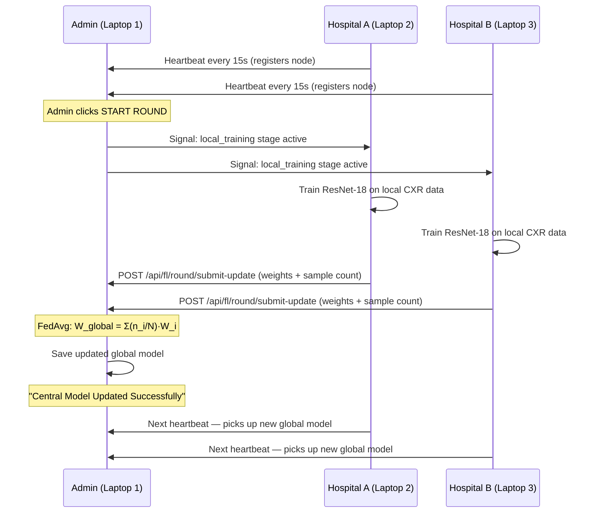

# 🏥 Federated Learning — 3-Laptop Setup & Execution Guide

> [!IMPORTANT]
> All 3 laptops must be on the **same Wi-Fi network**. Only model weights travel over the network — patient X-ray images never leave each laptop.

---

## Overview

| Role | Who | Actions |
|---|---|---|
| **Laptop 1 — Admin Server** | You (`10.0.9.61`) | Runs backend + frontend, starts FL rounds, monitors dashboard |
| **Laptop 2 — Hospital A** | Second laptop | Runs hospital node client, trains locally |
| **Laptop 3 — Hospital B** | Third laptop (Saika's) | Runs hospital node client, trains locally |

---

## STEP 0 — Before You Start (All Laptops)

### Find Admin IP (Laptop 1 only)
Open PowerShell on Laptop 1:
```powershell
ipconfig | findstr IPv4
```
Look for the Wi-Fi adapter address, e.g. `10.0.9.61`. **This is your `ADMIN_IP`.**

### Firewall — Allow Port 8000 (Laptop 1 only)
Run once in PowerShell **as Administrator**:
```powershell
netsh advfirewall firewall add rule name="PulmoScan FL Backend" dir=in action=allow protocol=TCP localport=8000
```

---

## STEP 1 — Start Admin Server (Laptop 1)

Open **two** PowerShell terminals.

### Terminal A — Backend
```powershell
cd "c:\Users\usnvk\Documents\Desktop1\Projects\Major Project"
python -m uvicorn backend.main:app --host 0.0.0.0 --port 8000 --h11-max-incomplete-event-size 104857600
```
Expected output:
```
INFO:     Uvicorn running on http://0.0.0.0:8000 (Press CTRL+C to quit)
```

> [!NOTE]
> The `--h11-max-incomplete-event-size 104857600` flag allows 100 MB request bodies (needed for weight uploads from hospital nodes).

### Terminal B — Frontend
```powershell
cd "c:\Users\usnvk\Documents\Desktop1\Projects\Major Project\Frontend"
npm run dev
```
Expected output:
```
VITE v6.4.3  ready in ~1500 ms
  ➜  Local:   http://localhost:5173/
  ➜  Network: http://10.0.9.61:5173/
```

### Open Dashboard
Open browser on Laptop 1 → `http://localhost:5173`  
Login: `admin@pulmoscan.org` / `password`  
Navigate to **FL Operations Hub** in the left sidebar.

---

## STEP 2 — Start Hospital Node on Laptop 2

> [!IMPORTANT]
> Laptop 2 must have the project cloned. If not, see "Clone Project on Hospital Laptops" below.

Open PowerShell on **Laptop 2**:
```powershell
cd "C:\path\to\Major-Project"
python Model/run_hospital_node.py --node_id node_A --api_server http://10.0.9.61:8000 --demo
```
Replace `10.0.9.61` with Laptop 1's actual Wi-Fi IP.

Expected output:
```
===========================================================
 HOSPITAL A — URBAN REFERRAL CENTER
===========================================================
[CLIENT] Node ID:         node_A
[CLIENT] REST API Hub:    http://10.0.9.61:8000
[CLIENT] Mode:            DEMONSTRATION (~15-25s round)
...
[CLIENT] Authentication successful with Central Server ✓
...
NODE READY FOR REAL-TIME FEDERATED TRAINING
  ▶ OPTION 1: Press [ENTER] to train with this dataset!
  ▶ OPTION 3: Or click 'START FEDERATED LEARNING ROUND' on Laptop 1 dashboard.
[FL] Listening for training round signal...
```

On **Laptop 1 dashboard**, `Connected Nodes: 1` should now appear.

---

## STEP 3 — Start Hospital Node on Laptop 3 (Saika's Laptop)

Open PowerShell on **Laptop 3**:
```powershell
cd "C:\Users\saika\Desktop\MP-V2\Major-Project"
python Model/run_hospital_node.py --node_id node_B --api_server http://10.0.9.61:8000 --demo
```

Expected output: same as Laptop 2 but showing `HOSPITAL B — RURAL DISTRICT CLINIC`.

On **Laptop 1 dashboard**, `Connected Nodes: 2` should now appear.

---

## STEP 4 — Start a Federated Learning Round

### Method A — Dashboard Button (Recommended)
On Laptop 1, click the blue **▶ START FEDERATED LEARNING ROUND** button (top-right of FL Operations Hub).

The FL Orchestration Modal opens:
- **Step 1**: Global model weights broadcast to all online nodes ✅
- **Step 2**: Independent Edge Training — progress bars animate for each hospital
- **Step 3**: Waiting for Model Updates — nodes upload weights after training
- **Step 4**: FedAvg Aggregation — admin combines weights
- **Step 5**: Global Model Update — shows **"Central Model Updated Successfully"**

### Method B — Press ENTER on a Hospital Laptop
In the terminal of Laptop 2 or 3 (while `[FL] Listening` message is shown), press **ENTER**.  
This triggers the round from the hospital side — same 5-step flow.

---

## STEP 5 — Run Multiple Rounds

After Step 5 completes, click **Dismiss** in the modal.  
Click **▶ START FEDERATED LEARNING ROUND** again for the next round.  
Each round uses the globally updated model from the previous round.

---

## Demo Mode vs Full Mode

| Flag | Speed | Epochs | Dataset |
|---|---|---|---|
| `--demo` | ~15–25s per round | 1 epoch, 4 batches | Subset of data |
| _(no flag)_ | Minutes per round | Full epochs | Full dataset |

---

## Clone Project on Hospital Laptops

If Laptop 2 or 3 doesn't have the project:

```powershell
git clone -b v2-development https://github.com/usnvk/Major-Project.git
cd Major-Project
pip install -r Model/requirements.txt
```

Then place TB X-ray data in the correct folder:
```
Model/data/hospital_A/   ← for node_A (Laptop 2)
  Normal/           (normal chest X-rays)
  Tuberculosis/     (TB-positive X-rays)

Model/data/hospital_B/   ← for node_B (Laptop 3)
  Normal/
  Tuberculosis/
```

---

## Dataset Folder Names — Accepted Variants

The system accepts these subfolder naming patterns (case-insensitive):

| Positive class | Negative class |
|---|---|
| `Tuberculosis` | `Normal` |
| `TB_Positive` | `TB_Negative` |
| `Positive` | `Negative` |

---

## Troubleshooting

| Problem | Solution |
|---|---|
| `Connection refused` from hospital laptop | Check firewall on Laptop 1; run the `netsh` command above |
| Dashboard shows `0 / 0` connected nodes | Hospital node not running yet, or heartbeat failed — restart the hospital node |
| Node goes offline during round | Re-run the hospital node script; it re-registers automatically |
| Round stuck at "Waiting for Model Updates" | A node disconnected mid-round. Click **Cancel Round**, restart hospital nodes, start new round |
| Backend crash on startup | Run `python -c "import ast; ast.parse(open('backend/main.py').read()); print('OK')"` to check syntax |
| `--node_id` error | Do NOT use `--node_id node_D` etc. with old script. Pull latest: `git pull origin v2-development` |

---

## Quick Reference — Commands Summary

```
# Laptop 1 (Admin) — Terminal A
python -m uvicorn backend.main:app --host 0.0.0.0 --port 8000 --h11-max-incomplete-event-size 104857600

# Laptop 1 (Admin) — Terminal B
cd Frontend && npm run dev

# Laptop 2 (Hospital A)
python Model/run_hospital_node.py --node_id node_A --api_server http://<ADMIN_IP>:8000 --demo

# Laptop 3 (Hospital B)
python Model/run_hospital_node.py --node_id node_B --api_server http://<ADMIN_IP>:8000 --demo

# Any extra laptop (Hospital C, D, ...)
python Model/run_hospital_node.py --node_id node_C --api_server http://<ADMIN_IP>:8000 --demo
```

---

## What Happens Under the Hood


